# 4. Median of Two Sorted Arrays

**One Hard a Day · Day 001** · LeetCode Hard · [problem page](https://leetcode.com/problems/median-of-two-sorted-arrays/) · pattern: **binary search on a partition**

> Two lists, both already sorted. Find the number in the middle of all of them.
> The obvious answer walks through a thousand numbers. The answer interviewers want makes about **ten guesses**. On the example below it needs **two**.

This README follows the video chapter by chapter: from brute force, to the merge, to the cut. Then come the proof, the bugs people ship, two more complete solutions, the version spread over a thousand machines, and the modern Java polish. Every solution is in [`solutions/`](solutions/) and is checked by [`Harness.java`](Harness.java).

```bash
./run.sh --no-timing     # examples, edge cases, 10,200 random cases, shards, homework
./run.sh                 # the same, plus the timing table
```

---

## Contents

1. [The question](#1-the-question)
2. [The honest first idea: glue, sort, pick](#2-the-honest-first-idea-glue-sort-pick)
3. [Merge to the middle](#3-merge-to-the-middle)
4. [The cut](#4-the-cut)
5. [Write it, line by line, then dry-run it](#5-write-it-line-by-line-then-dry-run-it)
6. [Why it can't be wrong](#6-why-it-cant-be-wrong)
7. [The bugs people ship](#7-the-bugs-people-ship)
8. [Another road: throw away k/2](#8-another-road-throw-away-k2)
9. [Search the value](#9-search-the-value)
10. [A thousand machines](#10-a-thousand-machines)
11. [Modern Java](#11-modern-java)
12. [Interview round: the whole map](#12-interview-round-the-whole-map)
13. [Homework](#13-homework)

The running example is used everywhere below:

```
A = [ 1, 4, 7, 10, 13 ]
B = [ 2, 3, 6, 15 ]

merged:  1  2  3  4 [6] 7  10  13  15      9 numbers → the 5th one → median = 6
```

---

## 1. The question

You get two arrays, each sorted from small to large. Either can be empty, but not both. Each holds at most **1,000** numbers between **−10⁶** and **10⁶**. Return the median of everything combined.

```
odd count  (9):  1  2  3  4 [6] 7  10  13  15        → 6, the middle value
even count (8):  1  2  3 [4  6] 7  10  15            → (4 + 6) / 2 = 5.0, the average of the two middles
```

The answer is a `double`: it can be `5.5`, not just `5`. Remember that, because it turns into a bug later.

The problem adds one more line: **the solution must run in O(log (m+n))**.

<details>
<summary><b>Your turn:</b> two thousand numbers at most. Why would linear time ever be too slow?</summary>

It isn't. The linear version takes about 1.3 µs at 1,000 numbers per array. The log-time rule is the real test: **can you binary search on something that isn't a value at all?** That question is the heart of this problem.
</details>

---

## 2. The honest first idea: glue, sort, pick

Glue the two arrays together, sort, and take the middle. → [`solutions/brute/Solution.java`](solutions/brute/Solution.java)

```java
int[] all = new int[a.length + b.length];
System.arraycopy(a, 0, all, 0, a.length);          // first array in
System.arraycopy(b, 0, all, a.length, b.length);   // second right after it
Arrays.sort(all);

int mid = all.length / 2;
if (all.length % 2 == 1) {
    return all[mid];                                // odd: the middle
}
return (all[mid - 1] + all[mid]) / 2.0;            // even: average; 2.0 keeps the half
```

```
glue:  1  4  7  10  13 | 2  3  6  15
sort:  1  2  3  4  6  7  10  13  15         ← we paid to sort numbers that were already sorted
```

| | cost |
|---|---|
| time | O((m+n) log(m+n)), about 22,000 comparisons at 2,000 numbers |
| space | O(m+n), a new array |

It works, and it passes. But both inputs were **already sorted**, and we threw that away. That is the wasted work.

---

## 3. Merge to the middle

Merge them like two queues: keep a finger on each array, and always take the smaller front value. → [`solutions/better/Solution.java`](solutions/better/Solution.java)

We don't need the whole merge, only enough of it to reach the middle. The loop runs `total/2 + 1` times and keeps just the last two values it took.

```java
int i = 0, j = 0;              // two fingers
int prev = 0, curr = 0;        // the last two values taken

for (int step = 0; step <= total / 2; step++) {
    prev = curr;
    boolean takeA = j == b.length
            || (i < a.length && a[i] <= b[j]);
    curr = takeA ? a[i++] : b[j++];
}
return total % 2 == 1 ? curr : (prev + curr) / 2.0;
```

```
A:  1  4  7  10  13          B:  2  3  6  15
    i                            j

step 1  take A → 1        taken: 1
step 2  take B → 2        taken: 1 2
step 3  take B → 3        taken: 1 2 3
step 4  take A → 4        taken: 1 2 3 4
step 5  take B → 6        taken: 1 2 3 4 6   ← stop: odd total, curr = 6
```

| | cost |
|---|---|
| time | O(m+n): 5 steps here, **1,001** at the limit |
| space | O(1) |

Better, but still linear, and the problem asked for log.

<details>
<summary><b>Your turn:</b> we only want the middle. Do we really need the order of everything to its left?</summary>

No. We only need to know **which** numbers end up on the left side. Their order doesn't matter at all. That observation is the whole solution.
</details>

---

## 4. The cut

Picture the median as a **wall**: everything left of it is small, everything right of it is big, and the left side holds half the numbers.

```
merged:   1  2  3  4  6 ║ 7  10  13  15
          └─── left ───┘   └── right ──┘
           (half = 5)
```

Now **un-merge**. The left side is just a front chunk of A plus a front chunk of B, so the wall becomes **two cuts**, one in each array:

```
A:   1   4 │  7   10   13         cutA = 2   (A gives 2 numbers)
B:   2   3   6 │ 15               cutB = 3   (B gives 3 numbers)
                                  2 + 3 = 5 = half ✓
```

The left side must hold `half` numbers, so **picking cutA forces `cutB = half − cutA`**. One number decides everything, and one number in a range is something we can binary search.

### How do we know a cut is right?

Look only at the four numbers touching the cuts:

```
              aLeft │ aRight
   A:  ...      4   │   7    ...
                     ╲ ╱
                      ╳          check across, not down
                     ╱ ╲
   B:  ...      6   │  15    ...
              bLeft │ bRight
```

Inside each array, left ≤ right is already true because the array is sorted. So only the **cross checks** matter:

| check | meaning if it fails | move |
|---|---|---|
| `aLeft ≤ bRight` | A gave away numbers that are too big | cutA **left** (`hi = cutA − 1`) |
| `bLeft ≤ aRight` | B gave numbers that are too big, so A must give more | cutA **right** (`lo = cutA + 1`) |

If both hold, every left number is ≤ every right number: that's the median wall.

<picture>
  <source media="(prefers-color-scheme: dark)" srcset="diagrams/cut-search-dark.svg">
  
</picture>

<sub>Archify diagram · <a href="diagrams/interactive/cut-search.html">interactive version</a> (download and open in a browser) · <a href="diagrams/src/">source</a></sub>

<details>
<summary><b>Your turn:</b> aLeft is bigger than bRight. Which way does cutA move?</summary>

**Left.** A gave away too many big numbers. Move its cut left, and cutB moves right on its own. If bLeft is bigger than aRight, it's the mirror: move cutA right.
</details>

We binary search the cut in the **shorter** array: positions `0..m`, so at most **10 probes** at m = 1,000. This is binary search on a **position**, not on a value.

---

## 5. Write it, line by line, then dry-run it

→ [`solutions/optimal/Solution.java`](solutions/optimal/Solution.java) (37 lines, paste-ready for LeetCode)

```java
class Solution {
    private static final int MIN = Integer.MIN_VALUE;   // stands in for "nothing on the left"
    private static final int MAX = Integer.MAX_VALUE;   // stands in for "nothing on the right"

    public double findMedianSortedArrays(int[] a, int[] b) {
        if (a.length > b.length) {
            return findMedianSortedArrays(b, a);        // always search the shorter array
        }
        int m = a.length, n = b.length;
        int half = (m + n + 1) / 2;                     // +1: on an odd total the left side holds the extra one
        int lo = 0, hi = m;                             // cutA can be 0 (take none) .. m (take all)

        while (lo <= hi) {
            int cutA = (lo + hi) / 2;
            int cutB = half - cutA;                     // forced by cutA

            int aLeft = cutA == 0 ? MIN : a[cutA - 1];
            int aRight = cutA == m ? MAX : a[cutA];
            int bLeft = cutB == 0 ? MIN : b[cutB - 1];
            int bRight = cutB == n ? MAX : b[cutB];

            if (aLeft > bRight) {
                hi = cutA - 1;                          // cutA too far right
            } else if (bLeft > aRight) {
                lo = cutA + 1;                          // cutA too far left
            } else {
                int leftMax = Math.max(aLeft, bLeft);
                if ((m + n) % 2 == 1) {
                    return leftMax;                     // odd: biggest on the left
                }
                int rightMin = Math.min(aRight, bRight);
                return (leftMax + rightMin) / 2.0;      // even: average across the wall
            }
        }
        throw new IllegalArgumentException("not sorted");   // unreachable for sorted input (see §6)
    }
}
```

### Dry run: odd total (9 numbers)

A has 5 numbers and B has 4, so we **swap**. Now `A = [2, 3, 6, 15]`, `B = [1, 4, 7, 10, 13]`, `m = 4`, `n = 5`, `half = 5`.

**Probe 1:** `lo = 0, hi = 4` → `cutA = 2`, `cutB = 3`

```
A:   2   3 │ 6   15                 aLeft = 3    aRight = 6
B:   1   4   7 │ 10   13            bLeft = 7    bRight = 10

aLeft 3 > bRight 10 ?   no
bLeft 7 > aRight 6  ?   YES  → B gave a number that's too big; A must give more → lo = 3
```

**Probe 2:** `lo = 3, hi = 4` → `cutA = 3`, `cutB = 2`

```
A:   2   3   6 │ 15                 aLeft = 6    aRight = 15
B:   1   4 │ 7   10   13            bLeft = 4    bRight = 7

aLeft 6 > bRight 7  ?   no
bLeft 4 > aRight 15 ?   no   → valid wall
left = {2, 3, 6, 1, 4}   leftMax = max(6, 4) = 6   odd total → answer 6 ✓
```

| probe | lo | hi | cutA | cutB | aLeft | aRight | bLeft | bRight | move |
|---|---|---|---|---|---|---|---|---|---|
| 1 | 0 | 4 | 2 | 3 | 3 | 6 | 7 | 10 | `lo = 3` |
| 2 | 3 | 4 | 3 | 2 | 6 | 15 | 4 | 7 | **found → 6** |

### Dry run: even total (8 numbers)

`A = [1, 4, 7, 10]`, `B = [2, 3, 6, 15]`, no swap, `half = 4`.

```
probe 1: cutA = 2, cutB = 2
A:   1   4 │ 7   10                 aLeft = 4   aRight = 7
B:   2   3 │ 6   15                 bLeft = 3   bRight = 6
4 > 6? no    3 > 7? no   → valid
leftMax = 4, rightMin = 6   → (4 + 6) / 2.0 = 5.0 ✓
```

Two probes and eight numbers read. The merge needed 5 steps here and 1,001 at the limit; **the cut needs at most 10 probes.**

---

## 6. Why it can't be wrong

**Each check fails on one side only.** As cutA moves right, `aLeft` only grows and `bRight` only shrinks (because cutB moves left). So once `aLeft > bRight` fails at some cut, it keeps failing everywhere further right. The second check is the mirror image on the left.

```
cutA:            0    1    2    3    4
aLeft > bRight:  ·    ·    ·    ·    ✗    ← once true, true to the right   → go left
bLeft > aRight:  ✗    ✗    ✗    ·    ·    ← once true, true to the left    → go right
valid:                          ✓
```

Every probe throws away a half that **cannot** contain a valid cut.

**A valid cut always exists.** Take the real merged order and draw the median wall in it. Whatever came from A is a front chunk of some size `cutA*`. At that cut, every left number is ≤ every right number, so both checks pass. The search can't skip it, which is why the final `throw` is unreachable for sorted input.

**Duplicates are safe** because the checks use strict `>`: equal numbers on both sides of a cut are allowed. (§7, bug 4 shows what `>=` does.)

| | the cut |
|---|---|
| time | **O(log min(m, n))**: 10 probes at 1,000, 20 at 10⁶ |
| space | O(1) |

Measured on JDK 21 at 10⁶ numbers per array (median of 15 runs):

| solution | time |
|---|---|
| sort | ~19 ms |
| merge to the middle | ~6 ms |
| **the cut** | **~58 ns** |

Before trusting any of this, the harness runs every solution against an independent reference (a merge in `long` arithmetic) on **10,200 random inputs**. Those include empty arrays, duplicates, negatives and the extreme values, and every solution agrees on all of them. In an interview, saying how you'd test it is part of the answer.

---

## 7. The bugs people ship

| # | bug | input | what happens |
|---|---|---|---|
| 1 | `/ 2` instead of `/ 2.0` | `[1, 2]` + `[3, 4]` | returns **2** instead of **2.5**: integer division drops the half |
| 2 | skipping the swap | A longer than B | `cutB = half − cutA` goes **negative** → reads `b[-1]` → crash |
| 3 | no sentinel for an empty side | a cut at index 0 or at the end | there is no neighbour there: `MIN` / `MAX` stand in for it |
| 4 | `>=` in the checks | five 7s: `[7, 7]` + `[7, 7, 7]` | every cut looks wrong, the loop runs out and **throws on valid input** |

Bugs 1 and 4 are reproduced by `Harness.java`:

```
bug 1, (2 + 3) / 2 on [1,2]+[3,4]: 2 instead of 2.5
bug 4, >= in the checks on five 7s: no cut found, would throw
```

---

## 8. Another road: throw away k/2

The second classic solution, and strong candidates know both: **turn the median into the k-th smallest.** → [`solutions/kth/Solution.java`](solutions/kth/Solution.java)

Look at the first `k/2` numbers of each array and compare the last number of each chunk. The chunk whose last number is smaller **can't contain the k-th smallest**, so drop it and subtract its size from `k`.

```
median of 9 → k = 5          A: 1 4 7 10 13     B: 2 3 6 15

k=5  step 2:  A[..1] = 1 4   B[..1] = 2 3    3 < 4 → drop B's 2, 3      k = 3
k=3  step 1:  A[..0] = 1     B[..2] = 6      1 < 6 → drop A's 1         k = 2
k=2  step 1:  A[..1] = 4     B[..2] = 6      4 < 6 → drop A's 4         k = 1
k=1:          min(7, 6) = 6                                             → 6 ✓
```

<picture>
  <source media="(prefers-color-scheme: dark)" srcset="diagrams/kth-elimination-dark.svg">
  
</picture>

<sub>Archify diagram · <a href="diagrams/interactive/kth-elimination.html">interactive version</a> (download and open in a browser) · <a href="diagrams/src/">source</a></sub>

<details>
<summary><b>Your turn:</b> why is it safe to throw away the smaller chunk?</summary>

Count what can be smaller than that chunk's last number: the rest of its own chunk, and at most k/2 from the other array. That's at most **k − 1** numbers, so nothing in the chunk can be the k-th smallest. Safe to drop.
</details>

```java
int step = k / 2;
int lastA = Math.min(i + step, a.length) - 1;   // clip to the end of the array
int lastB = Math.min(j + step, b.length) - 1;
if (a[lastA] <= b[lastB]) { k -= lastA - i + 1; i = lastA + 1; }
else                      { k -= lastB - j + 1; j = lastB + 1; }
```

For an even total, call it twice and average. Each round removes about half of k, so it takes **O(log(m+n))** rounds: at most 11 at the limit (k: 1001 → 501 → 251 → … → 1). The cut is tighter, because it works on the log of the *shorter* array in a single pass. Measured: **~133 ns** for this one vs **~58 ns** for the cut at 10⁶.

---

## 9. Search the value

A third road: forget positions and binary search on the **answer itself**. → [`solutions/value/Solution.java`](solutions/value/Solution.java)

Pick a value `v` and ask: *how many numbers are ≤ v?* That count only goes up as `v` goes up, so the k-th smallest is the **first v whose count reaches k**. Counting in a sorted array is one more binary search.

```
v:            1   2   3   4   5   6   7  ...
count(≤ v):   1   2   3   4   4   5   6  ...
                                  ▲
                    first v with count ≥ 5  → median = 6
```

```java
long lo = Integer.MIN_VALUE, hi = Integer.MAX_VALUE;
while (lo < hi) {
    long mid = Math.floorDiv(lo + hi, 2);        // NOT (lo + hi) / 2, see below
    int count = atMost(a, mid) + atMost(b, mid);
    if (count >= k) hi = mid; else lo = mid + 1;
}
```

**32 rounds** over the full int range, each with two small binary searches: about **3.7 µs** at 10⁶. That's slower than the cut, so why learn it?

1. **Its own trap.** With negative numbers, `/` rounds toward zero, not down. At `lo = −3, hi = −2` the midpoint comes out as `−2`, the range never shrinks, and the loop spins forever. `Math.floorDiv` rounds down and fixes it. (The harness shows the plain `/` version stuck after 1,000 iterations.)
2. **It doesn't care how many arrays there are.** Three sorted arrays, a sorted matrix, a thousand machines: you just add up the counts.

---

## 10. A thousand machines

The staff-level follow-up: the data no longer fits on one machine. It's split across **1,000 shards**, each sorted locally. Find the median. → [`solutions/sharded/ShardedMedian.java`](solutions/sharded/ShardedMedian.java)

<details>
<summary><b>Your turn:</b> which of the three ideas survives?</summary>

**The value search.** You can't merge a thousand machines, and the cut needs exactly two arrays. But every shard can answer one cheap question: *how many of yours are ≤ v?*
</details>

<picture>
  <source media="(prefers-color-scheme: dark)" srcset="diagrams/sharded-median-dark.svg">
  
</picture>

<sub>Archify diagram · <a href="diagrams/interactive/sharded-median.html">interactive version</a> (download and open in a browser) · <a href="diagrams/src/">source</a></sub>

Shards never send their data, only one number back per round. The harness tests this on 50 random clusters of 2 to 40 shards, and it matches the full sort every time.

**Think like a staff engineer.** Compute isn't the cost: each shard does about 20 steps even with a million numbers. The cost is **32 round trips, each waiting for the slowest shard**. So attack the rounds:
- sample a few values from each shard first, to start from a narrow range;
- hedge slow requests (send a duplicate after a timeout and take whichever answers first).

<details>
<summary><b>Your turn:</b> now numbers arrive forever, one at a time. What changes?</summary>

**Two heaps:** a max-heap for the low half and a min-heap for the high half, kept the same size (that's LeetCode 295, its own day). If exact isn't required, quantile sketches such as **t-digest** or **Greenwald–Khanna** keep an approximate median in a small, fixed amount of memory. Knowing when exact is worth paying for is the staff answer.
</details>

---

## 11. Modern Java

The cut already runs in tens of nanoseconds, and none of these changes make it faster. They make it **safer and clearer**. → [`solutions/modern/Solution.java`](solutions/modern/Solution.java)

```diff
-        if (a.length > b.length) {
-            return findMedianSortedArrays(b, a);
-        }
+        if (a.length > b.length) {
+            int[] t = a; a = b; b = t;               // tip 2: swap in place, one way in, one loop
+        }
         int m = a.length, n = b.length;
-        int half = (m + n + 1) / 2;
+        int half = (m + n + 1) >>> 1;
 ...
-            int cutA = (lo + hi) / 2;
+            int cutA = (lo + hi) >>> 1;               // tip 3: overflow-proof midpoint
 ...
-                if ((m + n) % 2 == 1) {
+                if (((m + n) & 1) == 1) {
 ...
-                return (leftMax + rightMin) / 2.0;
+                return ((long) leftMax + rightMin) / 2.0;   // tip 1: widen before you add
```

| tip | why |
|---|---|
| **1. widen before you add** | `leftMax + rightMin` is int + int and overflows *before* the divide. With the two largest ints the original returns **−1.5**; with the `long` cast it returns **2147483646.5**. A double holds every such long sum exactly. LeetCode's limits are ±10⁶, so it passes either way, but your interviewer's next question may not have those limits. |
| **2. swap in place** | no recursive call: the method stays flat, with one entry and one loop, so it's easier to trace on a whiteboard. |
| **3. `>>> 1` for midpoints** | `(lo + hi) >>> 1` stays correct even when the sum overflows an int. Here the range is only 1,000, so it's a habit, not a fix, but it's [the habit that fixed Java's own binary search in 2006](https://research.google/blog/extra-extra-read-all-about-it-nearly-all-binary-searches-and-mergesorts-are-broken/). For searches over values that can be negative, use `Math.floorDiv` (§9). |

Measured at 1,000 numbers per array: **38 ns before, 36 ns after** in the run behind the video, and 25 vs 28 ns in the harness output below. That's the same speed within noise, so the safer code costs nothing.

---

## 12. Interview round: the whole map

<picture>
  <source media="(prefers-color-scheme: dark)" srcset="diagrams/solution-map-dark.svg">
  
</picture>

<sub>Archify diagram · <a href="diagrams/interactive/solution-map.html">interactive version</a> (download and open in a browser) · <a href="diagrams/src/">source</a></sub>

| solution | time | space | when it's the right answer |
|---|---|---|---|
| sort | O((m+n) log(m+n)) | O(m+n) | the first thing you say, never the last |
| merge to the middle | O(m+n) | O(1) | the warm-up; correct and simple |
| **the cut** | **O(log min(m, n))** | O(1) | **the answer they want** |
| k-th elimination | O(log(m+n)) | O(1) | answers *any* k, not just the median |
| value search | O(32 · (log m + log n)) | O(1) | many arrays, a matrix, many machines |

At 10⁶ per array, the steps each one takes:

```
sort          ████████████████████████████████████████  41,863,137
merge         █                                          1,000,001
k-th          ▏                                                 42
value         ▏                                              2,560
the cut       ▏                                                 20
```

<details>
<summary><b>Your turn:</b> what's the exact time complexity of the cut?</summary>

**O(log min(m, n))**, the log of the shorter length. Saying O(log(m+n)) is true but loose, and it tells the interviewer you didn't notice why we swapped.
</details>

<details>
<summary><b>Your turn:</b> find the k-th smallest with the cut instead of the median.</summary>

Same cut. The left side holds **k** numbers instead of half, and the answer is the left max. The trap is merging up to k, which is linear again. Full code is in §13.
</details>

---

## 13. Homework

Change the cut to return the **k-th smallest** of two sorted arrays, and test it against the merge the same way the harness does.

<details>
<summary><b>Answer</b> (try it first)</summary>

→ [`homework/KthSmallest.java`](homework/KthSmallest.java)

The left side holds `k` numbers, so `cutB = k − cutA`, and cutA can only range over `max(0, k − n) .. min(m, k)`. The answer is the larger of the two left neighbours.

```java
static int kth(int[] a, int[] b, int k) {          // k is 1-based
    if (a.length > b.length) return kth(b, a, k);
    int m = a.length, n = b.length;
    int lo = Math.max(0, k - n), hi = Math.min(m, k);
    while (lo <= hi) {
        int cutA = (lo + hi) >>> 1, cutB = k - cutA;
        int aLeft = cutA == 0 ? Integer.MIN_VALUE : a[cutA - 1];
        int aRight = cutA == m ? Integer.MAX_VALUE : a[cutA];
        int bLeft = cutB == 0 ? Integer.MIN_VALUE : b[cutB - 1];
        int bRight = cutB == n ? Integer.MAX_VALUE : b[cutB];
        if (aLeft > bRight) hi = cutA - 1;
        else if (bLeft > aRight) lo = cutA + 1;
        else return Math.max(aLeft, bLeft);
    }
    throw new IllegalArgumentException("k out of range");
}
```

On the example, k = 3 gives **3** (cutA = 2, cutB = 1). The harness checks it against the merged order on **139,902** (arrays, k) cases with no failures.
</details>

---

## Files

```
0004-median-of-two-sorted-arrays/
├── README.md                     this breakdown
├── run.sh                        compile everything, run the harness
├── Harness.java                  examples, edge cases, differential test, bugs, homework, timing
├── solutions/
│   ├── brute/Solution.java       §2  glue + sort
│   ├── better/Solution.java      §3  merge to the middle
│   ├── optimal/Solution.java     §5  the cut
│   ├── kth/Solution.java         §8  throw away k/2
│   ├── value/Solution.java       §9  binary search on the value
│   ├── sharded/ShardedMedian.java §10 a thousand machines
│   └── modern/Solution.java      §11 the cut, modern Java
├── homework/KthSmallest.java     §13 k-th smallest with the cut
└── diagrams/                     Archify diagrams: sources, interactive HTML, light/dark SVG
```

<picture>
  <source media="(prefers-color-scheme: dark)" srcset="diagrams/harness-dark.svg">
  
</picture>

<sub>Archify diagram · <a href="diagrams/interactive/harness.html">interactive version</a> (download and open in a browser) · <a href="diagrams/src/">source</a></sub>

Each `solutions/*/Solution.java` is a paste-ready LeetCode `class Solution`. `run.sh` copies them into `build/` under distinct class names so the harness can run them side by side.

### Harness output

One full `./run.sh` on a cloud x86 VM with JDK 21. The timings are ns per call (median of 15 runs) and vary from machine to machine and run to run; the correctness lines don't.

```
examples + edge cases: PASS
differential: 10200 random cases, seed 20261102: ALL AGREE
full-int even median: want 2147483646.5 optimal -1.5 modern 2147483646.5
sharded: 50 random clusters of 2..40 shards: ALL AGREE
bug 1, (2 + 3) / 2 on [1,2]+[3,4]: 2 instead of 2.5
bug 4, >= in the checks on five 7s: no cut found, would throw
homework k-th via the cut: 139902 (arrays, k) cases: ALL AGREE
value search rounds over full int range: 32
trap '/' midpoint on negatives: lo=-3 hi=-2 after 1000 iterations (stuck if 1000)
optimal: worst probes over 20000 max-size cases: 10
m=n=1000: brute=6,850ns better=1,537ns optimal=25ns modern=28ns kth=70ns value=1,949ns sharded=2,822ns
m=n=100000: brute=1,628,973ns better=529,988ns optimal=37ns modern=44ns kth=112ns value=3,581ns sharded=3,626ns
m=n=1000000: brute=15,850,679ns better=5,058,555ns optimal=51ns modern=86ns kth=124ns value=4,256ns sharded=4,156ns
```

## References

- LeetCode 4, Median of Two Sorted Arrays: https://leetcode.com/problems/median-of-two-sorted-arrays/
- Problem frequency snapshot (20 Oct 2026): https://github.com/liquidslr/leetcode-company-wise-problems
- Joshua Bloch, *Extra, Extra – Read All About It: Nearly All Binary Searches and Mergesorts are Broken* (2006): https://research.google/blog/extra-extra-read-all-about-it-nearly-all-binary-searches-and-mergesorts-are-broken/
- Greenwald & Khanna, *Space-Efficient Online Computation of Quantile Summaries* (SIGMOD 2001): https://www.cis.upenn.edu/~sanjeev/papers/sigmod01_quantiles.pdf
- Ted Dunning, *Computing Extremely Accurate Quantiles Using t-Digests*: https://arxiv.org/abs/1902.04023
