# 42. Trapping Rain Water

One Hard a Day · Day 002 · LeetCode Hard · [problem page](https://leetcode.com/problems/trapping-rain-water/) · two pointers, monotonic stack

[](https://youtu.be/auBFP_EM_fw)

▶ **[Watch the video on YouTube](https://youtu.be/auBFP_EM_fw)** · [@shank-labs](https://www.youtube.com/@shank-labs)

> Ten bars. Rain falls. How much water stays trapped between them? The obvious answer does about 400 million reads at the limit. Two pointers do one pass, under 20,000 steps, with no extra memory. And moving the taller side instead of the shorter one gives you 14, not 13.

```bash
./run.sh --no-timing   # every correctness check, a few seconds
./run.sh               # plus timings (a few minutes)
```

## Contents

1. [The question](#1-the-question)
2. [Brute force](#2-brute-force)
3. [Remember the walls](#3-remember-the-walls)
4. [The insight](#4-the-insight)
5. [Write it](#5-write-it)
6. [Why it can't be wrong](#6-why-it-cant-be-wrong)
7. [The bugs people ship](#7-the-bugs-people-ship)
8. [Another road: the stack](#8-another-road-the-stack)
9. [The 2D version](#9-the-2d-version)
10. [A thousand machines](#10-a-thousand-machines)
11. [Modern Java](#11-modern-java)
12. [Interview round](#12-interview-round)
13. [Homework](#13-homework)

[Files](#files) · [Harness output](#harness-output) · [References](#references)

## The running example

```
bars = [2, 0, 3, 1, 0, 4, 1, 2, 0, 3]

  4                 █
  3        █  ~  ~  █  ~  ~  ~  █
  2  █  ~  █  ~  ~  █  ~  █  ~  █
  1  █  ~  █  █  ~  █  █  █  ~  █
     0  1  2  3  4  5  6  7  8  9 

(█ bar, ~ water)

water = 0 2 0 2 3 0 2 1 3 0   total 13
```

## 1. The question

You get an array of bar heights, each bar one unit wide. Rain falls on all of them. Return how much water is trapped. At most 20,000 bars, each up to 100,000 tall.

Look at one bar. The water above it rises until it spills over the lower of two walls: the tallest bar on its left and the tallest bar on its right.

```
water[i] = min(maxLeft, maxRight) - height[i]

bar 4:  tallest on the left 3, tallest on the right 4  ->  min(3, 4) - 0 = 3
```

That one line is the whole problem. Everything below is about computing it faster.

<details><summary><b>Your turn:</b> Twenty thousand bars. What complexity do the constraints allow?</summary>

20,000² is 400 million. That might squeeze through a judge, but an interviewer hears n² as “not done yet”. Linear is the bar, and the real question is whether you can do it without extra memory.

</details>

## 2. Brute force

Apply the formula to every bar directly: scan left for the tallest bar up to here, scan right for the tallest from here to the end. Include the bar itself, so the level is never below it.

```java
class Solution {
    public int trap(int[] bars) {
        int n = bars.length;
        int water = 0;
        for (int i = 0; i < n; i++) {
            int maxLeft = 0, maxRight = 0;
            for (int j = 0; j <= i; j++) {
                maxLeft = Math.max(maxLeft, bars[j]);
            }
            for (int j = i; j < n; j++) {
                maxRight = Math.max(maxRight, bars[j]);
            }
            int level = Math.min(maxLeft, maxRight);
            water += level - bars[i];
        }
        return water;
    }
}
```

It's correct, but the scans repeat. Bar 5 scans everything to its left; bar 6 scans almost the same bars again.

```
i = 5   reads 0 1 2 3 4 5 | 5 6 7 8 9
i = 6   reads 0 1 2 3 4 5 6 | 6 7 8 9     <- almost all of it again
```

At 20,000 bars that is n × (n + 1) = 400,020,000 reads. Measured: about **249 ms** for a single test.

The other honest idea, counting layer by layer, costs n × the tallest bar: with bars up to 100,000 tall, that's worse.

## 3. Remember the walls

<details><summary><b>Your turn:</b> The scans repeat. What can we remember instead?</summary>

The running maximum. The tallest bar from the left up to i is the larger of the tallest up to i − 1 and bar i itself.

</details>

One pass left to right fills `left`, one pass right to left fills `right`, and a third pass adds `min(left[i], right[i]) - bars[i]`.

```
bars   2 0 3 1 0 4 1 2 0 3
left   2 2 3 3 3 4 4 4 4 4
right  4 4 4 4 4 4 3 3 3 3
level  2 2 3 3 3 4 3 3 3 3
water  0 2 0 2 3 0 2 1 3 0   = 13
```

```java
class Solution {
    public int trap(int[] bars) {
        int n = bars.length;
        int[] left = new int[n];    // tallest in 0..i
        int[] right = new int[n];   // tallest in i..n-1

        left[0] = bars[0];
        for (int i = 1; i < n; i++) {
            left[i] = Math.max(left[i - 1], bars[i]);
        }
        right[n - 1] = bars[n - 1];
        for (int i = n - 2; i >= 0; i--) {
            right[i] = Math.max(right[i + 1], bars[i]);
        }

        int water = 0;
        for (int i = 0; i < n; i++) {
            int level = Math.min(left[i], right[i]);
            water += level - bars[i];
        }
        return water;
    }
}
```

Three passes: 39,999 + 39,999 + 60,000 = **139,998 array reads** instead of 400 million. Measured: about **73 µs**. The cost: two extra arrays of 20,000 ints.

<details><summary><b>Your turn:</b> Can you drop one of the two arrays?</summary>

Yes. Keep the right max array and carry max left as a single number during the last pass. One array left; the real question is whether you can drop the other one too.

</details>

## 4. The insight

To fill one bar, you don't need both maxima exactly. You only need the **smaller** one.

Suppose someone told you where the tallest bar is. Every bar to its left has a right wall at least that tall, so only max left matters there: sweep in from the left and you're done. Same from the right. Two pointers is that idea without knowing where the peak is.

Put one pointer at each end. Keep the tallest bar seen from the left and the tallest seen from the right.

<details><summary><b>Your turn:</b> The left bar is shorter than the right bar. Whose water do we know for sure?</summary>

The left one. The right bar is taller, and it wears the crown: the tallest bar seen so far. That crown stands somewhere to the left bar's right and it's at least max left, so the left bar's right wall is at least that tall. The shorter of its two walls is on the left: max left. Its water is `maxLeft - height`, final, right now. On the example, bar 0 holds 2 − 2 = 0; the next bar holds 2 − 0 = 2.

</details>

```
  L                             R
  2  0  3  1  0  4  1  2  0  3        h[L] 2 < h[R] 3: the right bar is taller,
                                      so bar 0 is settled now: 2 - 2 = 0
```

If the right bar is the shorter one, it's the mirror: fill on the right and move right in. Every step settles one bar for good, and you keep five numbers.

<picture>
  <source media="(prefers-color-scheme: dark)" srcset="diagrams/two-pointers-dark.svg">
  
</picture>

<sub>Archify diagram · <a href="diagrams/interactive/two-pointers.html">interactive version</a> (download and open in a browser) · <a href="diagrams/src/">source</a></sub>

## 5. Write it

```java
class Solution {
    public int trap(int[] bars) {
        int left = 0, right = bars.length - 1;
        int maxLeft = 0, maxRight = 0;
        int water = 0;

        while (left < right) {
            if (bars[left] < bars[right]) {
                maxLeft = Math.max(maxLeft, bars[left]);
                water += maxLeft - bars[left];
                left++;
            } else {
                maxRight = Math.max(maxRight, bars[right]);
                water += maxRight - bars[right];
                right--;
            }
        }
        return water;
    }
}
```

Dry run on the example (each row settles one bar):

```
step  left right  bars[l] vs bars[r]   side   max          bar  water
 1     0    9      2 < 3               left   maxLeft = 2  0:+0    0
 2     1    9      0 < 3               left   maxLeft = 2  1:+2    2
 3     2    9      3 < 3 ? no          right  maxRight = 3 9:+0    2
 4     2    8      3 < 0 ? no          right  maxRight = 3 8:+3    5
 5     2    7      3 < 2 ? no          right  maxRight = 3 7:+1    6
 6     2    6      3 < 1 ? no          right  maxRight = 3 6:+2    8
 7     2    5      3 < 4               left   maxLeft = 3  2:+0    8
 8     3    5      1 < 4               left   maxLeft = 3  3:+2   10
 9     4    5      0 < 4               left   maxLeft = 3  4:+3   13
left = right = 5: they meet at the 4, the tallest bar, which holds nothing.
```

Thirteen, in nine moves. Time O(n), space O(1). Measured at 20,000 bars: about **17.5 µs**.

## 6. Why it can't be wrong

The whole proof: **the crown never leaves the pointers.**

- **Fact one.** Everything outside the pointers is finished, with `maxLeft` and `maxRight` on top of each side.
- **Fact two.** A pointer only steps off a bar when the other pointer's bar is at least as tall. So the tallest height seen so far always stays under a pointer.

<details><summary><b>Your turn:</b> Why can the tallest bar never be left behind?</summary>

A pointer only steps off a bar when the other pointer's bar is at least as tall (we move the strictly shorter side, and on a tie the right one). So the bar we leave is never taller than the one still under the other pointer.

</details>

So when the left bar is shorter, the right bar is the tallest so far, at least max left; the true right max can only be bigger. The level is max left, and adding `maxLeft - bar` is exact. The mirror case is the same argument, and ties work on the right with the sides swapped. There is no negative water: `maxLeft` already includes the bar under the pointer, because it is updated before the subtraction. Where the pointers meet, the crown is on that bar, so it's a tallest bar and holds nothing. Every other bar is filled exactly once.

Tested: every array solution against the direct formula in `long` math on 10,200 random inputs, the 10,000 small ones also against a layer-by-layer fill, plus flat ground, staircases, peaks and the maximum answer. They agree on every one. The harness also checks the invariant itself on 3,000 inputs: the tallest bar seen is always under a pointer.

## 7. The bugs people ship

| bug | on the example | what happens |
|---|---|---|
| only the left max | 17 instead of 13 | the water past the 4 spills off the right edge, but the code doesn't know |
| moving the taller side | 14 instead of 13 | it fills a bar whose limit was on the other side |
| walls without the bar itself | 6 instead of 13 | a tall bar gets negative water |
| `int` total | fits at the limit, wraps above it | the largest answer is two walls of 100,000 with nothing between: 1,999,800,000, only 7% below `Integer.MAX_VALUE`. At 30,000 bars the int answer wraps to −1,295,167,296 |

The fix for the last one is two lines (`solutions/modern/Solution.java`):

```diff
-        int water = 0;
+        long water = 0;
 ...
-        return water;
+        return Math.toIntExact(water);
```

At 30,000 bars it throws `ArithmeticException` instead of lying. In the video's paired run the `long` total cost about a microsecond at 20,000 bars; on other runs the difference is inside the noise (see the "tip one paired" lines below).

## 8. Another road: the stack

A second classic solution thinks in **rows, not columns**. Keep a stack of bars whose right wall hasn't arrived yet, heights going down. When a taller bar arrives, the bar on top is a floor: pop it. The new top is the left wall, the new bar is the right wall. The water on that floor is a slab: width = gap between the walls, depth = shorter wall − floor.

```java
class Solution {
    public int trap(int[] bars) {
        int[] stack = new int[bars.length];
        int top = -1;
        int water = 0;

        for (int i = 0; i < bars.length; i++) {
            while (top >= 0 && bars[stack[top]] < bars[i]) {
                int floor = bars[stack[top--]];
                if (top < 0) {
                    break;
                }
                int wall = stack[top];
                int width = i - wall - 1;
                int depth = Math.min(bars[wall], bars[i])
                        - floor;
                water += width * depth;
            }
            stack[++top] = i;
        }
        return water;
    }
}
```

On the example the slabs are 2, 1, 4, 1, 2, 3: thirteen again. Every bar is pushed once and popped at most once, so it's linear. The stack is a plain `int[]`, not a deque of `Integer`s:

| stack at 10⁶ bars | measured |
|---|---|
| `int[]` + top index | 11.7 ms |
| `ArrayDeque<Integer>` | 17.5 ms |
| `java.util.Stack` | 18.4 ms |

But the stack can hold every bar: on a falling staircase of 20,000 bars, all 20,000 wait.

<details><summary><b>Your turn:</b> Now the bars arrive one at a time, forever. Which solution still works?</summary>

The stack. Two pointers needs the right end, and a stream doesn't have one. The stack only looks back, and it adds water the moment a taller bar seals a pool, so every slab it adds is final: the running total is exactly the answer if the stream stopped right now.

</details>

For a real stream, change three things: keep the total and the indices in `long` (forever is a long time), keep each bar's height on the stack so you never store the stream, and pop equal heights too. Then the stack is strictly falling, one entry per height at most: with heights up to 100,000 it never holds more than **100,001** entries. The harness streams 2 × 10⁶ bars through it and measures a peak of exactly 100,001.

```java
// The stack, made for a stream: bars arrive one by one.
// Pops equal heights too, so the stack strictly falls and
// holds at most one entry per height: memory O(max height).
class StreamWater {
    private final int[] stackHeight;
    private final long[] stackIndex;
    private int top = -1;
    private long count = 0;
    private long water = 0;

    StreamWater(int maxHeight) {
        stackHeight = new int[maxHeight + 2];
        stackIndex = new long[maxHeight + 2];
    }

    long add(int bar) {
        if (bar < 0 || bar >= stackHeight.length - 1) {
            throw new IllegalArgumentException("height");
        }
        long i = count++;
        while (top >= 0 && stackHeight[top] <= bar) {
            int floor = stackHeight[top--];
            if (top < 0) {
                break;
            }
            int wall = stackHeight[top];
            long width = i - stackIndex[top] - 1;
            int depth = Math.min(wall, bar) - floor;
            water += width * depth;
        }
        top++;
        stackHeight[top] = bar;
        stackIndex[top] = i;
        return water;
    }

    int depth() {
        return top + 1;
    }
}
```

## 9. The 2D version

The common follow-up: the bars become a 2D height map ([LeetCode 407](https://leetcode.com/problems/trapping-rain-water-ii/)).

<details><summary><b>Your turn:</b> In two dimensions, which wall decides where water leaks?</summary>

The lowest wall around it. So start from the lowest border cell and work inward: the same idea as the shorter pointer, always work from the lowest wall you know.

</details>

You can't take the four straight-line maxima: water escapes along winding paths.

```
9 9 9 0 9
9 9 9 0 9      the centre 0 is walled in by 9s on all four straight lines,
9 9 0 0 9      but it drains right, around the corner and out the top:
9 9 9 9 9      the straight lines say 9, the truth is 0
9 9 9 9 9
```

Put every border cell in a min-heap. Pop the lowest; each unvisited neighbour holds the popped height minus its own, if positive; then it joins the wall at the higher of the two. That's exact: the popped cell is the lowest wall around everything still unvisited, nothing inside can drain lower, and the neighbour can drain through it.

```java
import java.util.PriorityQueue;

class Solution {
    private static final int[][] DIRS =
            {{1, 0}, {-1, 0}, {0, 1}, {0, -1}};

    public int trapRainWater(int[][] map) {
        int rows = map.length, cols = map[0].length;
        boolean[][] seen = new boolean[rows][cols];
        PriorityQueue<int[]> wall =
                new PriorityQueue<>((a, b) -> a[0] - b[0]);

        for (int r = 0; r < rows; r++) {
            for (int c = 0; c < cols; c++) {
                if (r == 0 || c == 0
                        || r == rows - 1 || c == cols - 1) {
                    wall.add(new int[]{map[r][c], r, c});
                    seen[r][c] = true;
                }
            }
        }

        int water = 0;
        while (!wall.isEmpty()) {
            int[] low = wall.poll();
            for (int[] d : DIRS) {
                int r = low[1] + d[0], c = low[2] + d[1];
                if (r < 0 || c < 0 || r >= rows || c >= cols
                        || seen[r][c]) {
                    continue;
                }
                seen[r][c] = true;
                water += Math.max(0, low[0] - map[r][c]);
                wall.add(new int[]{
                        Math.max(low[0], map[r][c]), r, c});
            }
        }
        return water;
    }
}
```

On this bowl the inside fills to 3: **15 units**. Every cell is pushed and popped once: O(mn log mn). Checked against a brute-force reference on 3,000 random maps and a full 200 × 200 map.

```
3 3 3 3 3
3 1 2 1 3      water   2 1 2
3 2 0 2 3              1 3 1    = 15
3 1 2 1 3              2 1 2
3 3 3 3 3
```

## 10. A thousand machines

The staff-level follow-up: the bars are split, in order, across 1,000 machines.

<details><summary><b>Your turn:</b> What does one shard need to know about the others?</summary>

Only two numbers: the tallest bar anywhere to its left and the tallest anywhere to its right.

</details>

Round one: every shard sends its maximum; the coordinator sweeps those 1,000 numbers both ways and sends each shard its two outside walls. Round two: every shard runs two pointers seeded with those walls, in parallel, and sends back one number.

<picture>
  <source media="(prefers-color-scheme: dark)" srcset="diagrams/thousand-machines-dark.svg">
  
</picture>

<sub>Archify diagram · <a href="diagrams/interactive/thousand-machines.html">interactive version</a> (download and open in a browser) · <a href="diagrams/src/">source</a></sub>

Careful: the chapter-5 loop compares **bars**, and it can't be seeded, because the tallest bar may be outside the shard. Give it a shard `[1, 5]` with a wall of 10 outside and it says 9; the truth is 4. So the shard compares the **running maxima** instead: update both, then fill whichever side's max is smaller. The smaller max is exact, because the other side has a wall at least that tall.

```java
import java.util.List;

// Bars split in order across machines. Two rounds:
// 1) each shard reports its max, 2) each shard gets the
// tallest bar to its left and right, and fills locally.
class ShardedWater {
    static long trap(List<int[]> shards) {
        int k = shards.size();
        int[] wallLeft = new int[k], wallRight = new int[k];
        for (int s = 1; s < k; s++) {
            wallLeft[s] = Math.max(wallLeft[s - 1],
                    max(shards.get(s - 1)));
        }
        for (int s = k - 2; s >= 0; s--) {
            wallRight[s] = Math.max(wallRight[s + 1],
                    max(shards.get(s + 1)));
        }
        long water = 0;
        for (int s = 0; s < k; s++) {   // in parallel
            water += fill(shards.get(s),
                    wallLeft[s], wallRight[s]);
        }
        return water;
    }

    // two pointers, seeded with the walls outside
    static long fill(int[] h, int maxLeft, int maxRight) {
        int left = 0, right = h.length - 1;
        long water = 0;
        while (left <= right) {
            maxLeft = Math.max(maxLeft, h[left]);
            maxRight = Math.max(maxRight, h[right]);
            if (maxLeft < maxRight) {
                water += maxLeft - h[left++];
            } else {
                water += maxRight - h[right--];
            }
        }
        return water;
    }

    static int max(int[] h) {
        int m = 0;
        for (int x : h) {
            m = Math.max(m, x);
        }
        return m;
    }
}
```

Add the shards' answers in a `long` (a thousand shards overflow an `int` easily). At a million shards, skip the single coordinator and compute the walls as a parallel prefix max, log k rounds deep. Tested on 2,000 random inputs split into up to 40 shards; it matches every time.

## 11. Modern Java

LeetCode runs Java 25, so everything here compiles there, except the one preview feature flagged below. The two-pointer loop is already about as fast as it gets, so the four tips target the 2D heap, the thousand machines, and one trap.

| tip | Java | before → after | measured (the video's JDK 25 run) |
|---|---|---|---|
| 1. key the 2D heap safely | 16 | `(a, b) -> a[0] - b[0]` → `record Cell` + `comparingInt` | 200 × 200: `int[]` 10.4 ms, `comparingInt` 12.4 ms, record 10.1 ms, packed `long` 5.1 ms |
| 2. virtual threads for the fan-out | 21 | fixed pool of 64 → one virtual thread per call | 1,000 shards × 2 rounds × 10 ms: 339 ms, OS thread per call 320 ms, virtual 30 ms |
| 3. structured concurrency | 25 preview | plain futures → `StructuredTaskScope` | one shard fails at 5 ms: the round gives up in about 66 ms; none of the other 999 one-second calls complete |
| 4. the trap: stream the running max | 8 / 24 | loop → `Arrays.parallelPrefix` / `Gatherers.scan` | 20,000 bars: loop 73 µs, parallelPrefix 146 µs, scan 653 µs; at 10⁶: 3.6 / 5.7 / 115 ms |

Tip 1, the comparator (subtraction overflows when values are far apart; heights here are small, so it's safe, but it's a habit to drop):

```diff
-        PriorityQueue<int[]> wall =
-                new PriorityQueue<>((a, b) -> a[0] - b[0]);
+        PriorityQueue<int[]> wall =
+                new PriorityQueue<>(
+                        Comparator.comparingInt(a -> a[0]));
```

The record version is `solutions/variants/GridRecord.java`; the packed key (height and cell in one `long`) is `solutions/variants/GridPacked.java`. Tip 2 is `solutions/sharded/FanOut.java` (`Executors.newVirtualThreadPerTaskExecutor()`); tip 3 is `solutions/preview/ScopedFanOut.java`, which `run.sh` compiles separately with `--enable-preview`. Tip 4 is `solutions/variants/BetterPrefix.java` and `BetterScan.java`: both read beautifully and both are slower than the plain loop, because every value is boxed and pushed through a stream pipeline. Readable is not the same as fast; measure.

## 12. Interview round

| approach | time | space | measured at 20,000 bars |
|---|---|---|---|
| brute force | O(n²) | O(1) | 249 ms |
| remember the walls | O(n) | O(n), two arrays | 73 µs |
| **two pointers** | **O(n)** | **O(1)** | **17.5 µs** |
| monotonic stack | O(n) | O(n) | 215 µs |
| 2D heap (LeetCode 407) | O(mn log mn) | O(mn) | 10.4 ms at 200 × 200 |
| 1,000 machines | O(n / k) per shard | two rounds, two numbers per shard | |

```
time per test at 20,000 bars (log scale, 1 µs to 1 s)
brute force         ████████████████████████████████████████  249 ms
remember the walls  ███████████████                             73 µs
two pointers        ██████████                                  17.5 µs
the stack           ███████████████████                        215 µs
```

<picture>
  <source media="(prefers-color-scheme: dark)" srcset="diagrams/solution-map-dark.svg">
  
</picture>

<sub>Archify diagram · <a href="diagrams/interactive/solution-map.html">interactive version</a> (download and open in a browser) · <a href="diagrams/src/">source</a></sub>

<details><summary><b>Your turn:</b> Now every bar has its own width. What changes?</summary>

Only the add. The water above a bar is its depth times its width, so the total wants a `long`. Which side moves, and why, is untouched. The harness checks this against the same bars expanded into unit-width bars on 3,000 inputs.

</details>

## 13. Homework

[LeetCode 11, Container With Most Water](https://leetcode.com/problems/container-with-most-water/). Same two pointers, different question, and the bars in between don't matter. Why does the shorter side move there too?

<details><summary><b>Answer</b></summary>

```java
// Homework answer: LeetCode 11, Container With Most Water.
// Same two pointers, different question: two lines and
// the x-axis hold the water; bars in between don't matter.
// Move the shorter line: moving the taller one only
// shrinks the width and never raises the min: it can't win.
class Solution {
    public int maxArea(int[] bars) {
        int left = 0, right = bars.length - 1;
        int best = 0;
        while (left < right) {
            int h = Math.min(bars[left], bars[right]);
            best = Math.max(best, h * (right - left));
            if (bars[left] < bars[right]) {
                left++;
            } else {
                right--;
            }
        }
        return best;
    }
}
```

Tested against an O(n²) brute force on 5,000 random inputs.

</details>

## Files

```
0042-trapping-rain-water/
├── README.md
├── run.sh                         compile everything and run the harness (JDK 24+); the LeetCode files also compile at Java 8 level
├── Harness.java                   examples, edges, differential test vs a long-math reference, bugs, follow-ups, homework, timings
├── solutions/
│   ├── brute/Solution.java        O(n²)
│   ├── better/Solution.java       remember the walls: O(n), two arrays
│   ├── optimal/Solution.java      two pointers: O(n), O(1)
│   ├── modern/Solution.java       two pointers with a long total and toIntExact
│   ├── stack/Solution.java        monotonic stack
│   ├── grid/Solution.java         2D, LeetCode 407 (min-heap)
│   ├── grid-modern/Solution.java  2D with Comparator.comparingInt
│   ├── sharded/ShardedWater.java  1,000 machines: walls + seeded fill
│   ├── sharded/FanOut.java        the coordinator on virtual threads (Java 21)
│   ├── preview/ScopedFanOut.java  structured concurrency (Java 25 preview)
│   └── variants/                  StreamWater, GridRecord, GridPacked, StackDeque, StackLegacy, BetterPrefix, BetterScan
├── homework/Solution.java         LeetCode 11
└── diagrams/                      Archify sources, interactive HTML, light/dark SVGs
```

<picture>
  <source media="(prefers-color-scheme: dark)" srcset="diagrams/harness-dark.svg">
  
</picture>

<sub>Archify diagram · <a href="diagrams/interactive/harness.html">interactive version</a> (download and open in a browser) · <a href="diagrams/src/">source</a></sub>

## Harness output

A full `./run.sh` on a 2-core cloud VM, JDK 25. Timings vary from run to run and machine to machine; the correctness lines don't. The numbers quoted above (and in the video) come from the episode's frozen run on the same kind of machine, which is why they differ slightly from this one.

```
JVM 25.0.4.1+1-1-24.04.4-Ubuntu, 2 cores
episode example [2, 0, 3, 1, 0, 4, 1, 2, 0, 3] -> 13
examples + edge cases: PASS
max water at the limits: 1999800000 (int max 2147483647)
differential: 10200 random cases, seed 20261103: ALL AGREE
beyond limits (30,000 bars): want 2999800000 optimal -1295167296 modern ArithmeticException: integer overflow
sharded: 2000 random inputs, 1..40 shards: ALL AGREE
2D: 3000 random maps up to 8x8: ALL AGREE; bowl example -> 15
2D at 200x200: all four heaps [128903825, 128903825, 128903825, 128903825] vs reference 128903825 AGREE
homework container: 5000 random cases: ALL AGREE
bug 'walls exclude the bar itself' on the episode example: 6 instead of 13
bug 'move the taller side' on the episode example: 14 instead of 13
bug 'left max only' on the episode example: 17 instead of 13
seeded shard [1,5], wall 10 on the left: bar-comparing loop 9, max-comparing fill 4, true 4
stream: running total equals the prefix answer after every bar (3000 streams): ALL AGREE
stream of 2*10^6 bars (falling staircases, then random), heights 0..10^5: stack peak 100001 (bound 100,001)
2D corner map: straight-line level 9, water by reference 0, by the heap 0
widths: two pointers with water times width vs expanded unit bars (3000 inputs): ALL AGREE
fan-out coordinator on virtual threads: 300 random clusters: ALL AGREE
invariant: tallest bar seen is under a pointer (3000 inputs): ALWAYS
optimal pointer moves on the example: 9
stack peak depth on a decreasing staircase of 20000: 20000
n=20000: brute=292,029,237ns better=69,646ns optimal=23,801ns stack=253,188ns modern=23,772ns deque=427,835ns legacy=412,891ns prefix=121,062ns scan=573,246ns
n=1000000: brute=skipped better=3,773,575ns optimal=1,180,009ns stack=13,335,247ns modern=1,150,451ns deque=22,412,571ns legacy=21,183,801ns prefix=4,853,535ns scan=154,225,391ns
fan-out 1,000 shards x 10 ms: fixed pool of 64 platform threads=344ms; platform thread per call=390ms; virtual thread per call=34ms;
tip one paired, n=20000: int total 25,748ns, long total 24,894ns (-3.3%)
tip one paired, n=1000000: int total 1,187,379ns, long total 1,163,120ns (-2.0%)
2D 200x200: grid int[]=12,181,206ns grid comparingInt=15,387,421ns grid record=13,788,145ns grid packed long=5,794,459ns
structured, 1000 x 1 s, one fails at 5 ms: failed fast: shard 7 after 55 ms; calls completed: 0
EXIT 0
```

## References

- LeetCode 42, Trapping Rain Water: https://leetcode.com/problems/trapping-rain-water/
- LeetCode 407, Trapping Rain Water II: https://leetcode.com/problems/trapping-rain-water-ii/
- LeetCode 11, Container With Most Water: https://leetcode.com/problems/container-with-most-water/
- Problem frequency snapshot: https://github.com/liquidslr/leetcode-company-wise-problems
- JEP 395, Records: https://openjdk.org/jeps/395
- JEP 444, Virtual Threads: https://openjdk.org/jeps/444
- JEP 505, Structured Concurrency (Fifth Preview): https://openjdk.org/jeps/505
- JEP 485, Stream Gatherers: https://openjdk.org/jeps/485
- Archify (diagrams): https://github.com/tt-a1i/archify
