# 410. Split Array Largest Sum

One Hard a Day · Day 003 · LeetCode Hard · [problem page](https://leetcode.com/problems/split-array-largest-sum/) · binary search on the answer, greedy check

[](https://youtu.be/zXVvwUzPtu8)

▶ **[Watch the video on YouTube](https://youtu.be/zXVvwUzPtu8)** · [@shank-labs](https://www.youtube.com/@shank-labs)

> Seven numbers. Cut them into three pieces so the heaviest piece is as light as possible. At the limit there are about 4.7 × 10⁸³ ways to cut the array; trying them all would take longer than 10⁶⁷ years. Stop searching for the cuts and guess the answer instead: about 30 guesses, one pass each, about 11 µs.

```bash
./run.sh --no-timing   # every correctness check, a few seconds
./run.sh               # plus timings (about a minute)
```

## Contents

1. [The question](#1-the-question)
2. [Try every cut](#2-try-every-cut)
3. [Remember the best](#3-remember-the-best)
4. [The insight](#4-the-insight)
5. [Write it](#5-write-it)
6. [Why it can't be wrong](#6-why-it-cant-be-wrong)
7. [The bugs people ship](#7-the-bugs-people-ship)
8. [Same shape elsewhere](#8-same-shape-elsewhere)
9. [A thousand machines](#9-a-thousand-machines)
10. [Modern Java](#10-modern-java)
11. [Interview round](#11-interview-round)
12. [Homework](#12-homework)

[Files](#files) · [Harness output](#harness-output) · [References](#references)

## The running example

```
nums = [4, 9, 3, 6, 2, 7, 5],  k = 3

  4  9 │ 3  6  2 │ 7  5
  ────   ───────   ────
   13       11      12      heaviest piece = 13  ← the answer
```

## 1. The question

You get an array of non-negative numbers and a count `k`. Cut the array into `k` pieces, each a run of neighbours and none empty, and return the smallest possible weight of the heaviest piece. At most 1,000 numbers, each at most 10⁶, and `k` at most `min(50, n)`.

```
cut after 4 and 3:      4 │ 9 3 │ 6 2 7 5     → 4, 12, 20   heaviest 20
another cut:            4 9 3 │ 6 2 │ 7 5     → 16, 8, 12   heaviest 16
the best cut:           4 9 │ 3 6 2 │ 7 5     → 13, 11, 12  heaviest 13
```

Two facts frame every answer: it is **at least the biggest number** (9, because 9 sits in some piece) and **at most the total** (36, everything in one piece).

<details><summary><b>Your turn:</b> 1,000 numbers, 50 pieces. What complexity do the constraints allow?</summary>

1,000² × 50 is 50 million steps: fine for a judge, so a careful dynamic program passes. But there is an answer that does about 30,000 steps, and that's the one an interviewer remembers.
</details>

## 2. Try every cut

The honest first idea: try every place for the first cut and solve the rest the same way. Take one number for the first piece, then two, then three, always leaving at least one number for every later piece. For each choice the worst piece is the larger of the first piece and the best answer for the rest; keep the smallest worst.

```java
class Solution {
    public int splitArray(int[] nums, int k) {
        return best(nums, 0, k);
    }

    // heaviest piece of the best split of
    // nums[start..] into k pieces
    private int best(int[] nums, int start, int k) {
        if (k == 1) {
            int sum = 0;
            for (int i = start; i < nums.length; i++) {
                sum += nums[i];
            }
            return sum;
        }
        int answer = Integer.MAX_VALUE;
        int first = 0;
        // leave at least one number for every later piece
        int lastEnd = nums.length - k;
        for (int end = start; end <= lastEnd; end++) {
            first += nums[end];
            int rest = best(nums, end + 1, k - 1);
            int worst = Math.max(first, rest);
            answer = Math.min(answer, worst);
        }
        return answer;
    }
}
```

On the example that is 15 ways, and the best is 13. At the limit it is choosing 49 cut points out of 999 gaps: C(999, 49) ≈ 4.73 × 10⁸³ ways. Measured on small inputs at about 4.6 ns a way, that is at least **6.9 × 10⁶⁷ years** (extrapolated).

The wasted work: different first cuts lead to the same question about the same suffix, solved again and again.

```
first piece 4      → best of [9 3 6 2 7 5] in 2 pieces
first piece 4 9    → best of   [3 6 2 7 5] in 2 pieces
first piece 4 9 3  → best of     [6 2 7 5] in 2 pieces   ← and "[6 2 7 5] in 1 piece"
                                                            is asked again from other branches
```

## 3. Remember the best

<details><summary><b>Your turn:</b> the same question gets solved again and again. What can we remember instead?</summary>

The best answer for each smaller question, kept in a table: the same idea as the tree, flipped to prefixes so it fills left to right.
</details>

`best[j][i]` is the best answer for the first `i` numbers in `j` pieces. To fill one cell, try every place for the last cut: the worst piece is the larger of the best for what's before the cut and the last piece itself. Keep the smallest. A prefix array gives every piece's weight in one subtraction.

```java
class Solution {
    public int splitArray(int[] nums, int k) {
        int n = nums.length;
        int[] prefix = new int[n + 1];
        for (int i = 0; i < n; i++) {
            prefix[i + 1] = prefix[i] + nums[i];
        }
        // best[j][i]: first i numbers in j pieces
        int[][] best = new int[k + 1][];
        best[1] = prefix.clone();
        for (int j = 2; j <= k; j++) {
            int[] prev = best[j - 1];
            best[j] = new int[n + 1];
            for (int i = j; i <= n; i++) {
                int low = Integer.MAX_VALUE;
                for (int cut = j - 1; cut < i; cut++) {
                    int last = prefix[i] - prefix[cut];
                    int worst = Math.max(prev[cut], last);
                    low = Math.min(low, worst);
                }
                best[j][i] = low;
            }
        }
        return best[k][n];
    }
}
```

```
            i = 1   2   3   4   5   6   7
  values:       4   9   3   6   2   7   5
  1 piece       4  13  16  22  24  31  36
  2 pieces      ·   9  12  13  13  16  20
  3 pieces      ·   ·   9   9  11  13  13   ← bottom-right: 13
```

At the limit that is about **23.3 million** inner steps, measured at about **4.7 ms**. It passes.

One easy win: scan the last cut from right to left and stop as soon as the last piece alone is heavier than the best found so far. Same table, one row at a time (`best` now holds the previous row, `next` the row being filled):

```java
class Solution {
    public int splitArray(int[] nums, int k) {
        int n = nums.length;
        int[] prefix = new int[n + 1];
        for (int i = 0; i < n; i++) {
            prefix[i + 1] = prefix[i] + nums[i];
        }
        int[] best = prefix.clone();     // one piece
        for (int j = 2; j <= k; j++) {
            int[] next = new int[n + 1];
            for (int i = j; i <= n; i++) {
                int low = Integer.MAX_VALUE;
                // stop once the last piece alone is too big
                for (int cut = i - 1; cut >= j - 1; cut--) {
                    int last = prefix[i] - prefix[cut];
                    if (last >= low) break;
                    int worst = Math.max(best[cut], last);
                    low = Math.min(low, worst);
                }
                next[i] = low;
            }
            best = next;
        }
        return best[n];
    }
}
```

That is **1.8 million** steps on the limit input, about **2.1 ms**. Still about n² · k, and it never asked the obvious question.

## 4. The insight

Instead of asking where the cuts go, ask something easier: **could the heaviest piece be 15 or less?** Walk left to right and keep adding numbers to the current piece until the next one would push it past 15; then cut and start a new piece.

```
limit 15:   4 9 │ 3 6 2 │ 7 5      13, 11, 12 → 3 pieces ≤ k = 3 → yes
```

<details><summary><b>Your turn:</b> why is it safe to fill each piece as full as it can go?</summary>

Because every number is zero or more, cutting later never hurts. Greedy's first piece ends as late as any valid split's first piece can, and from there it stays at least as far along, piece after piece. So if any split fits in k pieces, greedy does too.

```
limit 15, two valid splits:

greedy        4 9 │ 3 6 2 │ 7 5          13 · 11 · 12        3 pieces
another       4 │ 9 3 │ 6 2 │ 7 5        4 · 12 · 8 · 12     4 pieces
                ↑       ↑
greedy's cuts are never behind: after 2 numbers vs 1, after 5 vs 3.
The other split's first piece can't grow past greedy's: 4 9 3 = 16 > 15.
```
</details>

Now ask that question for every limit from 9 to 36:

```
limit     9  10  11  12  13  14  15  16  …  36
pieces    5   5   5   4   3   3   3   3  …   1
fits?     no  no  no  no YES yes yes yes …  yes
                         ↑ the first yes: 13
```

A bigger limit can only need fewer pieces, so the answers form a wall: no, no, no, then yes forever. The answer is the first yes, and a wall like that is exactly what binary search finds: the same shape as [Day 001](../0004-median-of-two-sorted-arrays/), but over the answer instead of an index.

<picture>
  <source media="(prefers-color-scheme: dark)" srcset="diagrams/greedy-check-dark.svg">
  
</picture>

<sub>Archify diagram · <a href="diagrams/interactive/greedy-check.html">interactive version</a> (download and open in a browser) · <a href="diagrams/src/">source</a></sub>

## 5. Write it

The low end is the biggest number, the high end the total. While the range has more than one value, try the middle: if it fits in k pieces the answer is the middle or lower (keep it as the new high end); otherwise the low end jumps past it. When the ends meet, that's the answer.

```java
class Solution {
    public int splitArray(int[] nums, int k) {
        int lo = 0, hi = 0;
        for (int num : nums) {
            lo = Math.max(lo, num);
            hi += num;
        }
        while (lo < hi) {
            int mid = lo + (hi - lo) / 2;
            if (pieces(nums, mid) <= k) {
                hi = mid;
            } else {
                lo = mid + 1;
            }
        }
        return lo;
    }

    // fewest pieces when no piece may weigh more than limit
    private int pieces(int[] nums, int limit) {
        int count = 1, sum = 0;
        for (int num : nums) {
            if (sum + num > limit) {
                count++;
                sum = num;
            } else {
                sum += num;
            }
        }
        return count;
    }
}
```

<picture>
  <source media="(prefers-color-scheme: dark)" srcset="diagrams/binary-search-dark.svg">
  
</picture>

<sub>Archify diagram · <a href="diagrams/interactive/binary-search.html">interactive version</a> (download and open in a browser) · <a href="diagrams/src/">source</a></sub>

The dry run on the example (from the harness):

```
probe  lo  hi  mid   greedy at mid                pieces   verdict
  1     9  36   22   4 9 3 6 │ 2 7 5                 2      fits      → hi = 22
  2     9  22   15   4 9 │ 3 6 2 │ 7 5               3      fits      → hi = 15
  3     9  15   12   4 │ 9 3 │ 6 2 │ 7 5             4      too many  → lo = 13
  4    13  15   14   4 9 │ 3 6 2 │ 7 5               3      fits      → hi = 14
  5    13  14   13   4 9 │ 3 6 2 │ 7 5               3      fits      → hi = 13
                                                   lo = hi = 13 after 5 guesses
```

At the limit the range is about a billion wide, so at most 30 guesses of 1,000 steps each: 30,000 steps. Measured: about **11 µs**, about **427× faster** than the plain table and **191× faster** than the table with the break. Time O(n log(sum)), space O(1).

## 6. Why it can't be wrong

Three facts make it airtight:

1. **Greedy finds the fewest pieces for any limit.** Its cuts are never behind any other valid split's cuts (§4), so it never needs more pieces than they do.
2. **The answers flip only once.** Raise the limit and every piece can only grow, so the count can only fall.
3. **The answer is in the range.** Below the biggest number nothing fits; at the total, one piece fits.

<details><summary><b>Your turn:</b> the check asks for at most k pieces, not exactly k. Why is fewer still fine?</summary>

You can always cut a piece again. That never makes any piece heavier, and with at least k numbers there is always somewhere to cut. So "at most k" and "exactly k" have the same answer.
</details>

The harness tests all seven versions against an independent every-cut reference on 10,000 random inputs and 32 hand-picked edge cases, and the fast ones against the table on 300 inputs at the limit. They agree on every one.

<picture>
  <source media="(prefers-color-scheme: dark)" srcset="diagrams/harness-dark.svg">
  
</picture>

<sub>Archify diagram · <a href="diagrams/interactive/harness.html">interactive version</a> (download and open in a browser) · <a href="diagrams/src/">source</a></sub>

## 7. The bugs people ship

| bug | input | what happens |
|---|---|---|
| low end starts at 0, not the biggest number | `[1, 9]`, k = 2 | returns **1** (truth 9): below the biggest number the greedy check lies. It still gives 13 on the example, and was wrong on 2,974 of 10,000 random inputs |
| count starts at 0 | the example | **12** (truth 13): the last piece is never counted |
| `lo = mid` instead of `lo = mid + 1` | the example | stuck at **lo = 12** forever: the range 12..13 has middle 12, too small, and lo never moves |
| `>=` instead of `>` in the check | the example | **14** (truth 13): a piece weighing exactly the limit gets cut early |
| `(lo + hi) / 2` past the limits | 1,500 × 10⁶, k = 1 | overflows: returns 886,433,245 (truth 1,500,000,000). At LeetCode's limits lo + hi peaks at 2 × 10⁹, 7% under int max; it overflows from 1,074 numbers of 10⁶ |
| `int` total past the limits | 3,000 × 10⁶ | −1,294,967,296 (truth 3,000,000,000); the total overflows from 2,148 numbers of 10⁶ |

## 8. Same shape elsewhere

The pattern: you want the **smallest value where a yes-or-no question flips**, and checking one guess is cheap. LeetCode 1011, Capacity to Ship Packages Within D Days, is this problem with new names: the ship's capacity is the limit and the days are the pieces. Any "smallest speed, capacity or size that's enough" has the same wall.

<details><summary><b>Your turn:</b> what if the numbers could be negative?</summary>

The wall is still a wall: a heavier limit can only help. What dies is the one-pass check: with negatives, taking more can make a piece lighter, so filling greedily stops being safe. Even the bounds lie: on `[2, −2]`, k = 1, lo = 2 and hi = 0, so the loop never runs and the code returns 2; the truth is 0. And "fewer pieces is fine" dies too: `[5, −5]` weighs 0 as one piece but 5 as two. LeetCode promises no negatives; with them you're back to the plain table, without the early break.
</details>

## 9. A thousand machines

The staff-level follow-up: a million numbers split in order across 1,000 machines; find the best split into 50 pieces.

<details><summary><b>Your turn:</b> one guess needs the greedy to run left to right across every machine. How do you avoid shipping the numbers?</summary>

Up front, each machine sends two numbers: its biggest value and its total (that's lo and hi). For each guess the coordinator walks the machines in order, **carrying the open piece's weight**. A machine whose total still fits costs no message: the coordinator adds it locally. Only where a cut must land does it send `(limit, carry)`; the machine runs the greedy on its own numbers and sends back `(cuts, new carry)`. Once it has counted more than 50 pieces the guess has failed, so it stops: at most about 50 round trips a guess.
</details>

<picture>
  <source media="(prefers-color-scheme: dark)" srcset="diagrams/thousand-machines-dark.svg">
  
</picture>

<sub>Archify diagram · <a href="diagrams/interactive/thousand-machines.html">interactive version</a> (download and open in a browser) · <a href="diagrams/src/">source</a></sub>

`solutions/sharded/ShardedSplit.java` simulates it. On a million random numbers (seeded):

```
39 guesses · 1,728 round trips (at most 50 per guess, one after another)
8,912 values shipped (2,000 up front, 4 per round trip) · 1,000,000 numbers never move
answer 9,991,189,702  → past int max: it needs a long
```

Be honest about the cost: within a guess the round trips are sequential, because each needs the carry from the last. At an assumed 0.5 ms a round trip, that's about 0.9 s of waiting. A million ints is only 4 MB: ship them to one machine and it solves them in about 16 ms. **At this size, shipping wins.** It pays at a billion numbers (4 GB you'd rather not move): each round trip adds at least one cut, so a guess never needs more than about 50, however big the data.

<details><summary><b>Your turn:</b> can you cut the round trips by sending several guesses at once?</summary>

Partly. Send 15 guesses per walk and the search splits the range 16 ways at a time: **39 walks become 10**. But round trips only drop from **1,728 to 1,415**, because a walk stops at every machine where any of the 15 needs a cut. Batching saves walks, not latency. The harness checks the batched walk on 52,051 cases.
</details>

## 10. Modern Java

LeetCode runs Java 25. The loop is already about as fast as it gets, so these tips are about safety and about where streams belong.

```diff
 class Solution {
     public int splitArray(int[] nums, int k) {
-        int lo = 0, hi = 0;
+        long lo = 0, hi = 0;
         for (int num : nums) {
             lo = Math.max(lo, num);
             hi += num;
         }
         while (lo < hi) {
-            int mid = lo + (hi - lo) / 2;
+            long mid = lo + (hi - lo) / 2;
             if (pieces(nums, mid) <= k) {
                 hi = mid;
             } else {
                 lo = mid + 1;
             }
         }
-        return lo;
+        return Math.toIntExact(lo);
     }
 
     // fewest pieces when no piece may weigh more than limit
-    private int pieces(int[] nums, int limit) {
-        int count = 1, sum = 0;
+    private int pieces(int[] nums, long limit) {
+        int count = 1;
+        long sum = 0;
```

| tip | what | measured (video run) |
|---|---|---|
| 1. longs for the sums | a `long` total and `Math.toIntExact` at the end turn a silent wrong answer into a right one, or a loud `ArithmeticException` | random input 11.0 → 11.3 µs · every value 10⁶: 8.9 → 10.3 µs |
| 2. streams for setup, loops in the hot path | `Arrays.stream(nums).max()` plus `.asLongStream().sum()` read nicely but make two passes; the check carries a running sum, so it stays a plain loop | setup: loop 612 ns · two streams 1.1 µs (×1.8), once |

Note the `asLongStream()`: an `IntStream` sum can overflow. `solutions/modern/Solution.java` keeps the loop.

## 11. Interview round

<picture>
  <source media="(prefers-color-scheme: dark)" srcset="diagrams/solution-map-dark.svg">
  
</picture>

<sub>Archify diagram · <a href="diagrams/interactive/solution-map.html">interactive version</a> (download and open in a browser) · <a href="diagrams/src/">source</a></sub>

| approach | time | space | at n = 1,000, k = 50 (video run) | note |
|---|---|---|---|---|
| try every cut | C(n−1, k−1) | O(k) stack | ≈ 6.9 × 10⁶⁷ years (extrapolated) | hopeless |
| DP table | O(k n²) | O(k n) | 4.7 ms | survives negatives |
| DP with break | O(k n²) worst | O(n) | 2.1 ms | faster in practice |
| binary search on the answer | O(n log sum) | O(1) | 11.0 µs | the one they want |
| 1,000 machines | ≤ ~50 round trips a guess | O(1) per machine | 39 guesses, 1,728 round trips | numbers stay put |

```
steps at the limit (log scale)
DP table        ████████████████████████████████  23,319,100
DP with break   ████████████████████████           1,836,416
binary search   ████████                              29,000
```

<details><summary><b>Your turn:</b> now you must also return the cuts, not just the weight. What changes?</summary>

One more greedy pass at the answer gives you the cuts for free. It might make fewer than k pieces; then cut any piece with room, just like in §6.
</details>

<details><summary><b>Your turn:</b> now the numbers are doubles. What breaks?</summary>

Halving the range never lands exactly: with doubles you'd stop after a fixed number of halvings and accept an approximate answer. To stay exact, use this: the answer is always the weight of some piece. List every run's weight, adding each one left to right exactly the way the check adds a piece, sort the list, and binary search it (`solutions/variants/DoubleCandidates.java`; the int version is `CandidateSearch.java`). That's 500,500 weights in memory and a sort, about the cost of the table with the break, so use it only when you need exact. Checked against the every-cut reference on 3,000 random double inputs: exactly equal.
</details>

## 12. Homework

LeetCode 875, Koko Eating Bananas: piles of bananas, an hours budget, find the smallest eating speed that finishes in time. Same wall, a different check.

```
piles 4 9 6 2, budget 6 hours
speed   1   2   3   4   5   6   7   8   9
hours  21  11   8   ?   ?   ?   ?   ?   ?     the smallest speed under the line?
```

<details><summary><b>Answer</b> (homework/Solution.java)</summary>

```java
// Homework answer: LeetCode 875, Koko Eating Bananas.
// Same pattern: guess the speed, check it in one pass,
// binary search the smallest speed that is fast enough.
class Solution {
    public int minEatingSpeed(int[] piles, int h) {
        int lo = 1, hi = 0;
        for (int pile : piles) {
            hi = Math.max(hi, pile);
        }
        while (lo < hi) {
            int mid = lo + (hi - lo) / 2;
            if (hours(piles, mid) <= h) {
                hi = mid;
            } else {
                lo = mid + 1;
            }
        }
        return lo;
    }

    // hours at this speed; long: 10^4 piles of 10^9
    // at speed 1 is 10^13 hours, far past an int
    private long hours(int[] piles, int speed) {
        long total = 0;
        for (int pile : piles) {
            total += (pile - 1) / speed + 1;
        }
        return total;
    }
}
```

Speed 5 on the example (hours at speeds 1..9: 21, 11, 8, 7, 6, 5, 5, 5, 4). The harness checks it against trying every speed on 5,000 random cases, and on 10⁴ piles of 10⁹ with h = 10⁹ (speed 10,000).
</details>

## Files

```
0410-split-array-largest-sum/
├── README.md
├── run.sh                              compile everything and run the harness (JDK 25)
├── Harness.java                        examples, 32 edge cases, seeded differential vs every-cut reference and the DP,
│                                       the bugs, sharded and batched walks, homework, timings
├── solutions/
│   ├── brute/Solution.java             try every cut
│   ├── dp/Solution.java                the table, O(k n²)
│   ├── dpfast/Solution.java            the table with the early break
│   ├── optimal/Solution.java           binary search on the answer
│   ├── modern/Solution.java            long sums, Math.toIntExact
│   ├── sharded/ShardedSplit.java       1,000 machines: carry walk, batched guesses
│   └── variants/                       Variants (setup loop vs streams), CandidateSearch, DoubleCandidates
├── homework/Solution.java              LeetCode 875
└── diagrams/                           Archify sources, interactive HTML, light/dark SVGs
```

Every `solutions/*/Solution.java` and `homework/Solution.java` is a paste-ready LeetCode `class Solution`; `run.sh` also compiles each one on its own at Java 25 with `-Xlint:all -Werror`.

## Harness output

Full `./run.sh` on a 2-core cloud x86 VM (Intel Xeon @ 2.10 GHz), JDK 25. Timings vary by machine; the correctness lines don't. The video's numbers come from an earlier run on the same kind of VM (DP 4.7 ms, DP with break 2.1 ms, binary search 11.0 µs, modern 11.3 µs, all-10⁶ 8.9 → 10.3 µs, streams ×1.8); this run's DP numbers are noisier.

```
JVM 25.0.4.1 · seed 20261105

1. example [4, 9, 3, 6, 2, 7, 5], k = 3
   brute = 13
   dp = 13
   dpfast = 13
   optimal = 13
   modern = 13
   longOnly = 13
   sharded = 13
   probe 1: lo 9 hi 36 mid 22 -> 2 pieces -> fits, hi = mid
   probe 2: lo 9 hi 22 mid 15 -> 3 pieces -> fits, hi = mid
   probe 3: lo 9 hi 15 mid 12 -> 4 pieces -> too many, lo = mid + 1
   probe 4: lo 13 hi 15 mid 14 -> 3 pieces -> fits, hi = mid
   probe 5: lo 13 hi 14 mid 13 -> 3 pieces -> fits, hi = mid
   answer 13 after 5 probes; the cut: 4 9 | 3 6 2 | 7 5 = 13, 11, 12
   pieces(x) for x = 9..16: 9:5 10:5 11:5 12:4 13:3 14:3 15:3 16:3

2. edge cases
   32 (array, k) edge cases x 7 solutions: all agree

3. random differential (seed 20261105)
   10000 random inputs (n 1..12, values up to 20 or 10^6) x 7 solutions vs every-cut reference: all agree
   300 random inputs up to n = 1,000, k = 50, values to 10^6: dpfast, optimal, modern, sharded match the DP
   1,000 x 10^6 with k = 1 -> 1,000,000,000 (int max is 2,147,483,647: the sum uses 47% of an int)

4. sharded probe: 793700 checks (exact count, and the capped fits-in-k decision) = sequential greedy

5. bugs
   lo = 0 instead of the max: [1, 9], k = 2 -> 1 (truth 9)
   (on the episode example it happens to give 13)
   lo = 0: wrong on 2974 of 10000 random inputs
   count starts at 0: example -> 12 (truth 13)
   lo = mid (no + 1): still looping after 1000 rounds, stuck at lo 12
   >= instead of >: example -> 14 (truth 13)
   (lo + hi) / 2 at LeetCode's limit (1,000 x 10^6, k = 1): 1000000000 in 29 rounds -> correct; lo + hi peaks at 2,000,000,000, 7% below int max (it overflows from 1,074 numbers)
   (lo + hi) / 2 at 1,500 x 10^6, k = 1: 886433245 after 1000 rounds (truth 1,500,000,000) -> overflow
   lo + (hi - lo) / 2 on the same input: 1500000000
   int sum of 3,000 x 10^6: -1294967296 (truth 3,000,000,000); sharded (long) -> 3000000000
   negatives (not allowed by LeetCode): [2, -2], k = 1 -> binary search says 2 (truth 0: the one piece weighs 0)
   candidate-sum search: 3000 random inputs vs every-cut reference: all agree
   doubles, candidate run weights: 3000 random inputs vs every-cut reference (same left-to-right adds): exactly equal
   sharded, batched guesses (B = 1, 2, 3, 7, 15): 52051 checks (answers and per-limit decisions) = sequential

6. homework (LeetCode 875): 5000 random cases vs trying every speed: all agree; 10^4 piles of 10^9, h = 10^9 -> speed 10000

7. step counts at the limit (n = 1,000, k = 50)
   DP inner steps: 23319100 · with the early break: 1836416 (this input)
   binary search probes: 29 (29000 greedy steps) · with the ceilDiv average bound: 29
   worst case probes: ceil(log2(10^9 - 10^6 + 1)) = 30
   all 10^6, k = 50: probes 30 · with the bound 30
   candidate-sum search at the limit: 500500 run sums, 19 probes, answer 10365113 (= binary search)

all correctness checks passed

8. timings (median of 15 after warm-up)
   n = 1,000, k = 50, random values to 10^6:
   DP: 14.9 ms · DP with break: 3.2 ms · binary search: 10.4 µs · long, no tricks: 11.6 µs · modern (long sums, checked return): 11.2 µs
   all 10^6, k = 50: binary search 11.4 µs · modern 11.9 µs
   setup only (max and sum), long warm-up: loop 610 ns · Arrays.stream twice 946 ns (x1.55)
   brute force n = 24, k = 6 (33649 ways): 158.0 µs = 4.7 ns per way
   at n = 1,000, k = 50: C(999, 49) = 4.73e+83 ways (84 digits) -> about 7.0e+67 years (extrapolated)
   network for the whole answer: 39 guesses · 1728 round trips (at most 50 per guess, one after another) · 8912 values shipped (2,000 up front, 4 per round trip) vs 1,000,000 numbers that never move
   batched, B = 15 guesses per walk: 10 walks · 1415 round trips (at most 537 per walk) · 26180 values shipped · answer 9991189702 (= unbatched)
   10^6 numbers on 1,000 shards, k = 50: answer 9991189702 (needs a long) · sharded (simulated, 2 cores) 1.3 ms · one machine 15.8 ms
```

## References

- LeetCode 410, Split Array Largest Sum: https://leetcode.com/problems/split-array-largest-sum/
- LeetCode 1011, Capacity To Ship Packages Within D Days: https://leetcode.com/problems/capacity-to-ship-packages-within-d-days/
- LeetCode 875, Koko Eating Bananas: https://leetcode.com/problems/koko-eating-bananas/
- `Math.toIntExact` (Java 25 API): https://docs.oracle.com/en/java/javase/25/docs/api/java.base/java/lang/Math.html
- Archify: https://github.com/tt-a1i/archify
- The video: https://youtu.be/zXVvwUzPtu8
